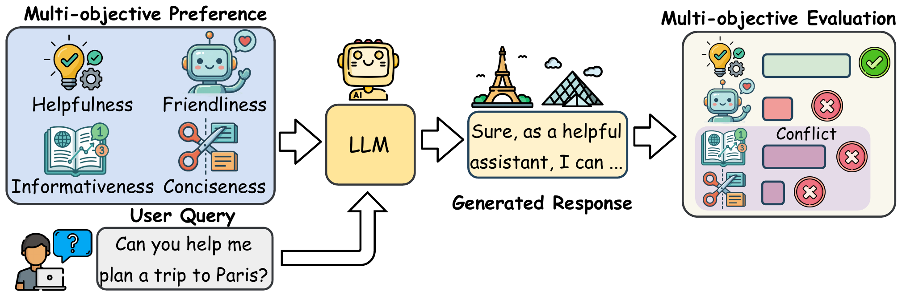
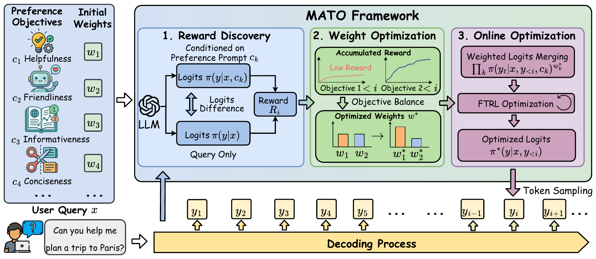

<div align="center">

#  MATO

### Multi-Objective Alignment with Test-time Optimization

**Balance multiple objectives as a language model generates.**

<p>
  <a href="https://www.python.org/downloads/"></a>
  <a href="https://pytorch.org/"></a>
  <a href="https://huggingface.co/docs/transformers/"></a>
</p>

[Paper](https://neurips.cc/virtual/2026/loc/sydney/poster/150723) · [Introduction](#introduction) · [Method](#method) · [Installation](#installation) · [Quick Start](#quick-start) · [Experiments](#experiments) · [Configuration](#configuration) · [Outputs](#outputs) · [Citation](#citation)

</div>

---

## Introduction

Personalizing a language model means balancing several preferences at once: a response may need to be helpful, friendly, informative, and concise. These objectives can conflict, and listing them in a prompt alone offers limited control over their relative importance. A response may satisfy some preferences while overlooking others.

<p align="center">
  <a href="assets/intro.png">
    
  </a>
</p>
<p align="center"><em>Multi-objective personalized alignment requires balancing competing preferences within a single response.</em></p>

**MATO** addresses this challenge through **training-free test-time optimization**. It recovers preference rewards from the backbone LLM, adapts objective weights as a response develops, and optimizes the next-token distribution to balance the requested preferences. Preferences are expressed in natural language with user-specified initial weights; decoding requires neither model fine-tuning nor external reward models.

## Method

MATO connects three modules in a token-by-token decoding loop:

<p align="center">
  <a href="assets/method.png">
    
  </a>
</p>
<p align="center"><em>MATO combines reward discovery, adaptive weight optimization, and online optimization throughout generation.</em></p>

1. **Reward discovery.** Compare the model's predictions under each individual preference prompt with its base predictions to recover objective-specific reward signals from the same backbone LLM.
2. **Weight optimization.** Update the initial preference weights using cumulative differential rewards over the generated prefix, adapting the balance between objectives as the response develops.
3. **Online optimization.** Combine the objective signals with the optimized weights and refine the next-token distribution using follow-the-regularized-leader (FTRL) optimization. Select a token, extend the generated prefix, and repeat.

The implementation evaluates base, combined, and individual objective prompts with a shared **decoder-only causal language model**. It supports configurable preference weights and optional batching of system prompts. External reward models are used only for post-generation evaluation in the helpfulness/humour experiment.

## Installation

Use **Python 3.11–3.13**. The commands below target a CUDA GPU; install a PyTorch build compatible with your CUDA environment.

```bash
git clone https://github.com/RManLuo/MATO.git
cd MATO

python -m venv .venv
source .venv/bin/activate
python -m pip install --upgrade pip
python -m pip install -e .
```

The editable install includes the `mato` package and its dependencies. Dependency bounds are defined in [pyproject.toml](pyproject.toml); [requirements.txt](requirements.txt) lists the dependencies without installing the local package.

Run all commands from the repository root. Models and datasets are loaded from Hugging Face; the default personalized reasoning model requires access to `meta-llama/Llama-3.1-8B-Instruct`.

<details>
<summary><strong>Configure an LLM judge for personalized reasoning</strong></summary>

Copy the example configuration and fill in the credentials for your chosen provider:

```bash
cp .env.example .env
```

| `--judge_provider` | Required environment variables | `--judge_model` |
| :--- | :--- | :--- |
| `openai` | `OPENAI_API_KEY` | Model name; default: `gpt-4o` |
| `azure_openai` | `AZURE_OPENAI_ENDPOINT`, `AZURE_OPENAI_API_KEY` | Azure deployment name |
| `anthropic` | `ANTHROPIC_API_KEY` | Anthropic model name |

Credentials can also be exported in your shell. The judge scripts load `.env` automatically. The quick start, reward-model evaluation, and dynamics visualization run without an external LLM judge.

</details>

## Quick Start

Generate one response and visualize how MATO balances helpfulness and humour. This example uses **Qwen3-0.6B** for a small first run; the experiment wrappers below use their own model defaults.

```bash
python script/visualize_mato_dynamics.py \
    --model_name_or_path Qwen/Qwen3-0.6B \
    --principles \
        "Helpfulness: The response should provide useful resources and suggestions to the user" \
        "Humour: The response should be cheerful and amusing" \
    --weights 0.5 0.5 \
    --principle_names "Helpfulness" "Humour" \
    --prompts "How can I stay motivated while learning to code?" \
    --max_new_tokens 128 \
    --device cuda:0 \
    --save_dir ./output/quickstart
```

Inspect `output/quickstart/sample_0.png` (or `.pdf`) for the trajectories and `output/quickstart/results.json` for the generated text and token traces.

## Experiments

This repository provides the reference implementation and three experiment workflows accompanying the paper:

| Experiment | Setting | Evaluation / output |
| :--- | :--- | :--- |
| [Personalized reasoning](#personalized-reasoning) | Per-sample preferences from [Multifaceted-Bench](https://huggingface.co/datasets/kaist-ai/Multifaceted-Bench) | LLM-as-judge scores and preference satisfaction metrics |
| [Helpful + humour alignment](#helpful--humour-alignment) | Preference weight sweeps on [HH-RLHF](https://huggingface.co/datasets/Anthropic/hh-rlhf) | Reward scores, hypervolume, and inner product |
| [Decoding dynamics](#decoding-dynamics) | Prompts with competing principles | Adaptive weight trajectories and cumulative differential rewards |

### Personalized reasoning

Generate responses using each sample's preferences, evaluate them against its rubrics, and print an aggregate report:

```bash
bash scripts/personalized_reasoning.sh
```

For a smaller run with a descriptive output directory:

```bash
DATASET_SIZE=10 EXP_NAME=personalized_demo \
    bash scripts/personalized_reasoning.sh
```

The report includes **Helpfulness**, **ACS** (average constraint satisfaction), **AMR** (all-match rate), **APS** (average preference score), preference score variance, and worst preference score. It also breaks results down by source dataset and preference dimension. ACS counts satisfied preferences per sample; AMR measures the fraction of samples satisfying every preference. The default satisfaction threshold is **4 out of 5**.

<details>
<summary><strong>Python commands: generation, judging, and reporting</strong></summary>

```bash
python script/personalized_reasoning/multifaceted_inference.py \
    --dataset_name multifaceted \
    --model_name_or_path meta-llama/Llama-3.1-8B-Instruct \
    --device cuda:0 \
    --exp_name mato \
    --run_judge true \
    --judge_provider openai \
    --judge_model gpt-4o

python script/personalized_reasoning/multifaceted_report.py \
    --judge_model gpt-4o \
    --eval_dir output/multifaceted/Llama-3.1-8B-Instruct/mato/mato/judge_eval_results.gpt-4o.json
```

To generate responses first and evaluate later, set `--run_judge false` in the inference command, then run:

```bash
python script/personalized_reasoning/multifaceted_judge_eval.py \
    --result_file output/multifaceted/Llama-3.1-8B-Instruct/mato/mato/results.json \
    --judge_provider openai \
    --judge_model gpt-4o
```

Generation and judging skip IDs already present in their saved results. The standalone judge also saves partial results periodically. To reevaluate all samples, pass `--resume false` to the standalone judge; saved error entries are otherwise skipped too.

The shell wrapper defaults to `EXP_NAME=mato-${DATASET_SIZE}`. The direct example above sets `--exp_name mato` explicitly; adjust report and judge paths to match your run.

</details>

### Helpful + humour alignment

Sweep preference weights, score each run with the helpfulness and humour reward models, and aggregate the results:

```bash
bash scripts/helpful_humor_pareto.sh
```

The default sweep uses seven **(helpfulness, humour)** weight pairs:

```text
(1.0, 0.0)  (0.8, 0.2)  (0.6, 0.4)  (0.5, 0.5)  (0.4, 0.6)  (0.2, 0.8)  (0.0, 1.0)
```

Override the sweep with a semicolon-separated list:

```bash
WEIGHTS_LIST="1.0 0.0;0.5 0.5;0.0 1.0" \
    bash scripts/helpful_humor_pareto.sh
```

Each weight setting produces mean and per-sample reward scores. The wrapper then saves the reward vectors, preference weights, hypervolume, and inner product in `summary_result_helpful_humor.json` for subsequent Pareto-front analysis.

<details>
<summary><strong>Python commands: one weight setting and aggregate evaluation</strong></summary>

```bash
python script/helpful_humor_pareto.py \
    --dataset_name hh-rlhf \
    --dataset_size 100 \
    --model_name_or_path Qwen/Qwen3-8B \
    --principles \
        "Helpfulness: The response should provide useful resources and suggestions to the user" \
        "Humour: The response should be cheerful and amusing" \
    --weights 0.5 0.5 \
    --reward_names helpful,humor \
    --device cuda:0 \
    --exp_name mato_helpful_humor
```

After generating the desired weight settings, aggregate them with:

```bash
python script/multi_objective_eval.py \
    --result_path output/hh-rlhf/Qwen3-8B/mato/mato_helpful_humor \
    --reward_names helpful,humor
```

The order of `--weights` must match `--principles` and `--reward_names`. To score an existing generation file independently, use [script/multi_reward_eval.py](script/multi_reward_eval.py) with `--result_file`, `--reward_names helpful,humor`, and `--device`.

</details>

### Decoding dynamics

Visualize adaptive weights and cumulative differential rewards across five pairs of competing principles:

```bash
bash scripts/visualize_mato_dynamics.sh
```

The wrapper covers **informativeness / conciseness**, **expertise / accessibility**, **positivity / truthfulness**, **formality / informality**, and **evidence / implication**. Each group contains three prompts and writes its plots and traces to a separate directory under `output/dynamics_vis/`.

<details>
<summary><strong>Python command: informativeness and conciseness</strong></summary>

```bash
python script/visualize_mato_dynamics.py \
    --model_name_or_path Qwen/Qwen3-8B \
    --principles \
        "Informativeness: The response should be comprehensive and include rich details, evidence, examples, and in-depth analysis to fully address the question." \
        "Conciseness: The response should be brief and to the point, avoiding unnecessary elaboration and only conveying the most essential information." \
    --weights 0.5 0.5 \
    --principle_names "Informativeness" "Conciseness" \
    --prompts \
        "What are the pros and cons of social media?" \
        "How does climate change affect biodiversity?" \
        "What should I consider when choosing a career?" \
    --max_new_tokens 256 \
    --rho 0.5 \
    --alpha 0.5 \
    --do_sample true \
    --temperature 0.7 \
    --device cuda:0 \
    --save_dir ./output/dynamics_vis/dynamics_info_vs_concise
```

For every prompt, the script saves `sample_<i>.pdf` and `sample_<i>.png`. Its `results.json` contains generated text, token IDs, token strings, adaptive weights, and cumulative differential rewards.

</details>

## Configuration

The shell wrappers accept environment variables so you can customize a run without editing scripts:

| Variable | Applies to | Purpose |
| :--- | :--- | :--- |
| `MODEL_NAME`, `DEVICE` | All wrappers | Model identifier or local path; execution device |
| `BATCH_INFERENCE` | All wrappers | Evaluate system prompts together; default: `false` |
| `DATASET_SIZE`, `EXP_NAME`, `SAVE_DIR` | Personalized reasoning and Pareto sweep | Sample count, run name, and output root |
| `JUDGE_PROVIDER`, `JUDGE_MODEL`, `JUDGE_NUM_WORKERS` | Personalized reasoning | Judge backend, model, and concurrency |
| `WEIGHTS_LIST` | Pareto sweep | Semicolon-separated preference weight pairs |
| `SAVE_ROOT`, `WEIGHTS`, `MAX_NEW_TOKENS`, `RHO`, `ALPHA` | Dynamics visualization | Output root, preferences, generation length, and MATO settings |

For example:

```bash
MODEL_NAME=Qwen/Qwen3-8B DEVICE=cuda:0 BATCH_INFERENCE=true \
    bash scripts/personalized_reasoning.sh
```

**Batching system prompts.** Add `--batch_inference true` to a Python inference entrypoint, or set `BATCH_INFERENCE=true` for a wrapper. The Python API exposes the same setting as `MATODecodingConfig(batch_inference=True)`.

Batch mode evaluates the base, combined, and individual objective prompts in one left-padded model batch, during both prefill and cached decoding. It still generates **one completion per user prompt**, with every row receiving the same selected token. Peak memory use increases, especially when prompt lengths differ; speedup depends on the model and hardware. The default is sequential evaluation.

Use `--help` on a Python entrypoint for all available options. The inference entrypoints set seed `42`; dataset subsets also use seed `42`. Use a distinct `EXP_NAME` when changing the model, sample subset, or decoding settings so that saved results belong to one configuration.

## Outputs

Dataset experiments save resolved arguments and generated responses alongside their evaluation files:

```text
output/
├── multifaceted/<model>/mato/<exp_name>/
│   ├── args.json
│   ├── results.json
│   └── judge_eval_results.<judge>.json
├── hh-rlhf/<model>/mato/<exp_name>/
│   ├── summary_result_helpful_humor.json
│   └── <weights>/                         # e.g. 0.5_0.5
│       ├── args.json
│       ├── results.json
│       ├── reward_eval_results.json
│       └── results_with_reward.json
└── dynamics_vis/<group>/
    ├── results.json
    ├── sample_0.pdf
    ├── sample_0.png
    └── ...
```

`<model>` is the final component of the model identifier, such as `Qwen3-8B`. Judge files appear after judge evaluation; the Pareto summary appears after aggregate evaluation. Dynamics traces use the directory supplied by `--save_dir` (or the wrapper's `SAVE_ROOT`).

## Repository Layout

```text
MATO/
├── README.md
├── pyproject.toml
├── requirements.txt
├── .env.example
├── assets/                               # Introduction and method figures
├── src/mato/
│   ├── data/                             # Dataset wrappers and prompt builders
│   ├── inference/                        # MATO decoder and decoding configuration
│   └── evaluation/                       # Reward models, LLM judge, and metrics
├── script/
│   ├── personalized_reasoning/
│   │   ├── multifaceted_inference.py
│   │   ├── multifaceted_judge_eval.py
│   │   └── multifaceted_report.py
│   ├── helpful_humor_pareto.py
│   ├── multi_objective_eval.py
│   ├── multi_reward_eval.py
│   └── visualize_mato_dynamics.py
└── scripts/
    ├── personalized_reasoning.sh
    ├── helpful_humor_pareto.sh
    └── visualize_mato_dynamics.sh
```

## Citation

If you use MATO in your research, please cite our [NeurIPS 2026 paper](https://neurips.cc/virtual/2026/loc/sydney/poster/150723):

```bibtex
@inproceedings{luo2026mato,
  title     = {{MATO}: Multi-objective Personalized Alignment with Test-time Optimization for Large Language Models},
  author    = {Linhao Luo and Trang Vu and Van-Anh Nguyen and Junae Kim and Reza Haffari and Dinh Phung},
  booktitle = {Advances in Neural Information Processing Systems},
  year      = {2026}
}
```

## Acknowledgements

This implementation uses [PyTorch](https://pytorch.org/) and [Hugging Face Transformers](https://huggingface.co/docs/transformers/). The experiments build on [Multifaceted-Bench](https://huggingface.co/datasets/kaist-ai/Multifaceted-Bench), [HH-RLHF](https://huggingface.co/datasets/Anthropic/hh-rlhf), and the [helpfulness](https://huggingface.co/Ray2333/gpt2-large-helpful-reward_model) and [humour](https://huggingface.co/mohameddhiab/humor-no-humor) reward models.
